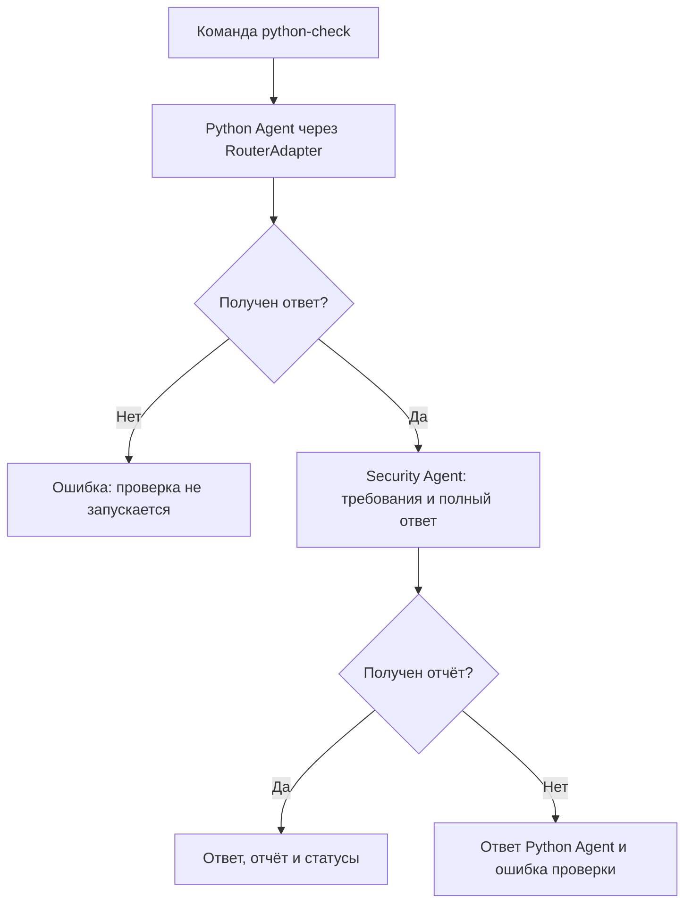

# PythonRouter

Локальный маршрутизатор задач для AI-агентов на Python. Выбирает исполнителя по его возможностям, отслеживает состояние задачи и объединяет генерацию Python-кода с последующим текстовым анализом.

**Python · Ollama · SQLite · unittest**

## Возможности

- Реестр агентов с включением, отключением и поиском по возможностям.
- Жизненный цикл задачи: создание, назначение, выполнение, завершение или ошибка.
- Два специализированных обработчика: Python Agent и Security Agent.
- Последовательный workflow: генерация ответа → анализ исходных требований и полученного ответа.
- Консольный чат, сохранение сессий и явно добавляемых фактов в SQLite.
- Демонстрационный обработчик для проверки маршрутизации без модели.

Проект предназначен для изучения архитектуры локальных агентных приложений. Маршрутизация основана на правилах: выбирается первый включённый агент со всеми необходимыми возможностями. Планирование задач с помощью LLM пока не реализовано.

## Архитектура

`RouterService` объединяет реестр, диспетчер и исполнитель. `RouterAdapter` предоставляет интерфейс командному слою и workflow. Клиент модели передаётся обработчикам через интерфейс `ChatClient`, поэтому в тестах его можно заменить.



Оба обработчика используют одну модель Ollama и один экземпляр клиента. Последовательные вызовы позволяют обойтись без одновременной загрузки нескольких моделей. Ответ первого этапа сохраняется в результате workflow даже при ошибке второго.

| Компонент | Назначение |
|---|---|
| `router/registry.py`, `router/task.py` | Реестр и модель задачи |
| `router/dispatcher.py`, `router/executor.py` | Выбор агента и выполнение обработчика |
| `router/service.py`, `router/adapter.py` | Координация и интерфейс результатов |
| `router/bootstrap.py` | Регистрация агентов и обработчиков |
| `router/python_agent.py`, `router/security_agent.py` | Подготовка запросов к модели |
| `router/ollama_client.py` | HTTP-клиент Ollama |
| `router/workflow.py`, `router/commands.py` | Последовательность этапов и команды |
| `main.py` | Консольный интерфейс |
| `storage.py`, `memory.py` | История и память в SQLite |
| `demo_workflow.py` | Демонстрация с длительностью и статусами этапов |
| `tests/` | Модульные и интеграционные тесты |

## Запуск

Python-зависимости ограничены стандартной библиотекой. Для запросов к модели нужны отдельно установленная Ollama и локальные веса `qwen3.5:9b-q4_K_M`.

Автоматический набор проверен на Python 3.12.14 в Linux. Ручной запуск с Ollama проверен в Windows на RTX 3060 12 GB и 16 GB RAM; это конфигурация проверки, а не минимальные требования.

Все команды ниже выполняются **из корня проекта**. Пример для Windows PowerShell:

```powershell
python -m venv .venv
.\.venv\Scripts\python.exe -X utf8 main.py
```

Перед запуском убедитесь, что Ollama запущена, а нужная модель присутствует в выводе `ollama list`. Приложение обращается к `http://127.0.0.1:11434/api/chat`. Установка Ollama и загрузка весов выполняются отдельно.

В меню выберите `0` для нового диалога либо номер сохранённой сессии.

| Команда в приложении | Действие |
|---|---|
| `агенты` | Показать зарегистрированных агентов |
| `демо: тест` | Проверить маршрутизацию без запроса к модели |
| `python: задача` | Получить ответ Python Agent |
| `python-check: задача` | Получить ответ и отчёт Security Agent |
| `память` | Показать сохранённые факты |
| `запомни: факт` | Добавить факт |
| `забудь: номер` | Удалить факт |
| `выход` или `exit` | Завершить приложение |
| Другой текст | Обычный диалог с локальной моделью |

## Демонстрация

```powershell
.\.venv\Scripts\python.exe -X utf8 -u demo_workflow.py
```

Скрипт передаёт Python Agent задачу написать `sum_positive(numbers)`, затем отправляет исходные требования и полный ответ Security Agent. Выводит число и длительность запросов, статусы и оба ответа. История SQLite не используется, сгенерированный код не исполняется.

При успешном запуске выполняются два последовательных запроса; оба этапа получают статус `completed`, процесс возвращает код `0`. Это означает завершение обработки, а не доказанную корректность или безопасность сгенерированного кода. Ответы модели могут различаться между запусками.

## Тесты

Без обращения к настоящей модели:

```powershell
$env:RUN_OLLAMA_LIVE = "0"
.\.venv\Scripts\python.exe -m unittest discover -s tests -v
```

Результат проверки от 30.10.2026: **156 тестов, 155 успешных, 1 пропущен**. Пропускается отдельный live-тест. Тесты проверяют маршрутизацию, переходы состояний, передачу материалов, обработку ошибок и интеграцию команд с подставными клиентами.

Отдельная проверка настоящей Ollama:

```powershell
$env:RUN_OLLAMA_LIVE = "1"
try {
    .\.venv\Scripts\python.exe -m unittest discover -s tests -p test_ollama_live.py -v
} finally {
    $env:RUN_OLLAMA_LIVE = "0"
}
```

Live-тест проверяет ответ модели на простой вопрос. Он не оценивает качество анализа Security Agent. Модульные тесты HTTP-клиента и отдельные тесты реального хранения в SQLite запланированы.

## Данные и настройки

При запуске консоли создаётся `data/chat_history.db`. Она хранит сообщения и добавленные пользователем факты. Память используется в обычном чате; специализированные агенты получают текущую задачу, а Security Agent — также ответ Python Agent. Удаление факта из памяти не удаляет его из старых сообщений.

Модель и параметры пока заданы в коде: `main.py`, `router/ollama_client.py` и `demo_workflow.py`. Тайм-аут запроса агента — 120 с, обычного чата — 180 с, отдельной демонстрации — 300 с. Данные, локальное окружение и резервные копии исключены через `.gitignore`.

## Ограничения

- Security Agent экспериментальный: в ручных проверках встречались ложные замечания и необоснованная оценка серьёзности. Отчёт требует проверки человеком.
- Успех workflow означает получение непустых текстовых ответов. Автоматического исполнения кода, исправления файлов и проверки предложенных тестов нет.
- История чата не сокращается автоматически; обработка длинного контекста пока не реализована.
- Реестр и задачи находятся в памяти процесса; SQLite хранит диалоги и факты, но не журнал задач.
- HTTP-клиент обычного чата и клиент агентов реализованы отдельно; обработку ошибок и конфигурацию предстоит унифицировать.

Планы развития — [ROADMAP.md](ROADMAP.md). История изменений — [CHANGELOG.md](CHANGELOG.md).
